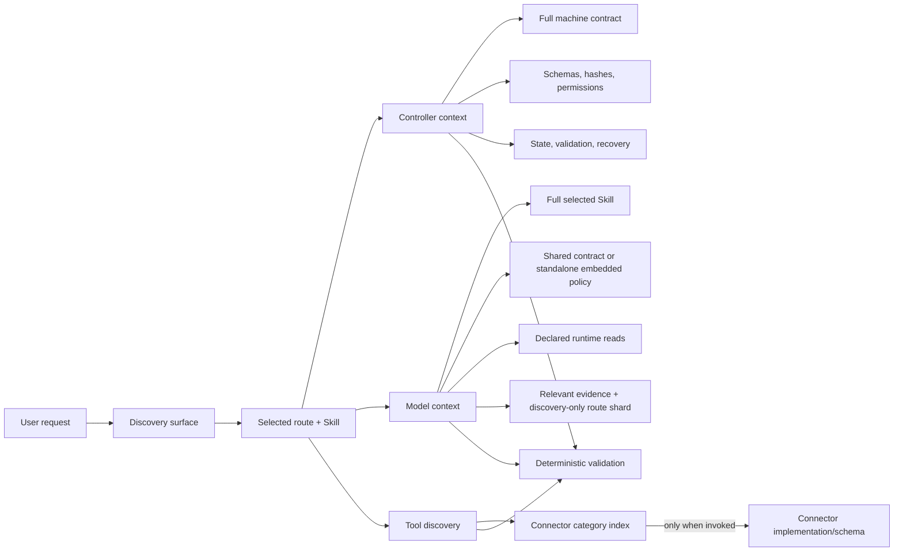

# Context Engineering Architecture

This repository uses a thin discovery/prompt layer over a thicker deterministic runtime. The goal is not to remove the harness; it is to stop paying model-context cost for controls that are better represented as schemas, hashes, selectors, capability checks, tool-side validation, and release gates.

The operational rule is:

> Give the model the smallest sufficient decision context. Keep authority, integrity, state, validation, observability, and recovery in the controller.

Focused ≤3 modules beat exhaustive dumps. The maintainer wiki at
[`references/wiki/`](../references/wiki/index.md) is **not** part of this
assembly. Runtime must not inject wiki; open it only for Accept / evolution
work. See [`evals/routing-retrieval/`](../evals/routing-retrieval/README.md).

## Outcome

The context path has five independently testable parts:

1. **Compact root navigation** — `CLAUDE.md` points to authoritative sources and carries a generated discovery index instead of duplicating full discipline manuals.
2. **Explicit runtime dependencies** — only an exact `### Runtime Reads` block creates a required Skill reference.
3. **Consumer-separated assembly** — controller, model, tool, and deferred bytes are accounted separately.
4. **Progressive disclosure artifacts** — runtime `/auto` projections, router facades, and connector sidecars expose only the current decision surface.
5. **One explicit representation** — full Skill content and the applicable host policy follow one supported assembly path; host and capability boundaries still apply.



## Measured Baseline and Changes

The following v19 measurements are historical, fixed at [the pre-v3 source commit](https://github.com/aaron-he-zhu/aaron-marketing-skills/tree/cac58547bc84ed2af865b68b90c5cfbb79b63978). They are UTF-8 bytes, not estimated tokens or a current-v3 performance claim. Provider token fields stay `null` until a provider reports them.

| Surface | Before | After | Change |
|---|---:|---:|---:|
| Root `CLAUDE.md` | 30,776 B | 14,407 B | −53.2% |
| Required bundle-reference declarations | 126 | 63 | −50.0% |
| Skills with required bundle references | 63 | 19 | −69.8% |
| Aggregate required-reference bytes across 120 Skills | 2,809,014 B | 841,939 B | −70.0% |
| Accidental required `CONNECTORS.md` references | 30 | 0 | −100% |
| Worst valid `/auto` static assembly | 83,385 B | 48,199 B | −42.2% |
The same historical real-manifest baseline (120 Skills × direct/auto routes) was:

| Metric | Direct | `/auto` |
|---|---:|---:|
| Required bytes p50 | 47,717 B | 52,298 B |
| Required bytes p95 | 78,749 B | 82,142 B |
| Required bytes max | 152,131 B | 174,240 B |
| Selected bytes p50 | 145,684 B | 149,618 B |

`selected_bytes` is resolver capacity accounting, not automatically model-visible context. `scripts/context-assembly.py` is the boundary that records which selected resources are controller bodies, model bodies, tool bodies, metadata-only, or deferred.

## Authoritative Sources

| Concern | Source |
|---|---|
| Business Skill topology | `references/system-catalog.json` |
| Capability tiers | `references/capability-profiles.json` |
| Host capabilities | `references/host-capability-profiles.json` |
| Explicit prompt representation and invariant overlays | `references/prompt-profiles.json` |
| Controller/model/tool modules | `references/context-modules.json` |
| Full shared behavior | `references/skill-contract.md` |
| Compact non-reducible behavior | `references/policy-kernel.md` |
| Per-Skill source-derived controller contracts | `references/skill-contracts/` |
| Context request/manifest | `references/context-request.schema.json`, `references/context-manifest.schema.json` |
| Consumer-separated assembly | `references/context-assembly.schema.json` |
| Context telemetry | `evals/context-usage-v1.schema.json` |
| Semantic behavior protocols | `evals/behavior-adapter-v2.schema.json`, `evals/behavior-adapter-v3.schema.json` |

Generated views never become independent truth. Machine contracts bind their source Skill and dependency hashes. Every router sidecar binds its host profile, catalog, facade, and target Skill hashes.

## Consumer Separation

### Controller context

The controller can inspect full authoritative material without injecting it into the model prompt. Its responsibilities include:

- validating route and distribution identity;
- verifying live Skill, contract, catalog, and reference hashes;
- enforcing byte/resource/sensitivity ceilings;
- applying conditional/XOR selection before reading an inactive branch;
- enforcing permission, path, capability, registry, audit, and release boundaries;
- writing immutable manifests and typed telemetry;
- retaining retry, recovery, and provenance state.

The machine contract is controller context. It is not a second copy of instructions for the model.

Inside a built distribution, assembly identity comes from the verified
`distribution-manifest.json`, never from a caller-supplied profile label. The
controller verifies the manifest inventory plus the hashes of the host and
prompt catalogs, context-module catalog, resolver, and assembler before it
assembles explicit context for the resolved host. A repository checkout without a
distribution manifest is explicitly identified as `repository`.

Assembly binds three independent identities after host resolution: the
physical package kind, the embedded planner distribution profile, and the
resolved host. Repository and plugin packages are deployable only as
`repository + shared-root host + repository planner` and
`plugin + manifest-bound shared-root host + plugin planner`, respectively.
The plugin manifest must enumerate the complete physical file inventory and
match the typed host capabilities, surfaces, catalog/definition hashes, and
generic-host router sidecar. A physical standalone payload is rejected because
the one-folder package does not ship the trusted planner/assembler runtime.

### Model context

The model receives only material necessary for the current reasoning step:

- the selected full Skill;
- the full shared contract, or the standalone Skill's embedded policy;
- exact runtime reads declared by the Skill;
- the active `/auto` shard only while route selection is the current reasoning step;
- selected project evidence relevant to the active step;
- an authored optional reference only after an explicit lookup event.

Optional prose links do not become eager model context simply because resolver capacity is available.
Protocol v3 discards the `/auto` shard after blind routing and reassembles the
execution candidate directly from the selected Skill. Routing case records,
including expected routes, target rubrics, blocking inputs, and `must_not`
criteria, never enter the candidate prompt or its staged source directory.

The explicit policy representation is host-aware. Generic shared-root and
Claude Code plugin hosts project the selected Skill plus
`references/skill-contract.md`. A repository-side standalone evaluation instead uses
`model-policy-standalone-embedded`: the non-reducible policy is already embedded
in its selected `SKILL.md`, so assembly projects and counts that Skill body once
and does not add a second shared-contract body. This repository-side
projection requires a serialized `distribution_evaluation_only` flag plus a
bounded evaluation run identity, is included in the assembly hash, and is
always `deployment_eligible=false`.

### Tool context

Connector and tool material follows two-stage disclosure:

1. expose a compact category/sidecar index;
2. load implementation details and schemas only when the selected category is invoked.

This prevents 30 historically accidental `CONNECTORS.md` dependencies from reappearing as static context. Tool availability does not authorize external mutation.

## Load Policies

`references/context-modules.json` defines a closed vocabulary:

| Policy | Meaning |
|---|---|
| `always` | Non-reducible representation for every applicable invocation |
| `activation` | Load when a specific Skill/route is selected |
| `conditional` | Load only after its closed condition is satisfied |
| `lookup-only` | Expose metadata/discovery first; body is read on demand |

Two model XOR groups guarantee one applicable primary representation:

- `model-skill-representation`
- `model-policy-representation`

Prompt and module catalogs use schema 2.0 with `explicit` as their only representation. Non-explicit requests fail clearly; the resolver never substitutes a missing policy or borrows unavailable host capabilities.

## Explicit Runtime Reads

Every required bundle reference must appear in one exact closed section:

```markdown
### Runtime Reads

- `../../../references/auditor-runbook.md`
- [runtime invocation](../../../references/runtime-invocation.md)
```

The parser accepts one repository-local `.md`/`.json` path per bullet. It rejects duplicate blocks, empty blocks, prose mixed into the block, external/unsafe paths, `SKILL.md`, duplicates, and invalid extensions. A fenced-code example has no control meaning.

Ordinary Markdown links, `**Reads:**`, `read-only`, `readout`, and lexical occurrences of “read” remain optional authored references. `scripts/generate-skill-contracts.py` is the source-derived projection and fails closed on malformed declarations.

## Distribution and Host Profiles

Host behavior is capability-based, not guessed from a product name:

| Host profile | Routing | References | Connectors |
|---|---|---|---|
| `standalone-skill-host` | Direct Skill | Skill-local only | None |
| `generic-shared-root-host` | Generated router Skills | Shared root | Sidecar |
| `claude-code-plugin-host` | Slash commands | Shared root | Native plugin + sidecar discovery |

Unknown/auto hosts fall back to the portable standalone profile. An explicitly misspelled host profile fails instead of silently widening capabilities.

Generic-host router facades are generated distribution artifacts. Their targets must cover all 120 business Skills exactly once and must resolve to the system catalog. They do not enter `.claude-plugin/plugin.json` and do not change the canonical 120-Skill count. Standalone packages remain direct one-Skill packages with truthful degraded capabilities.

Auditor activation uses a separate distribution XOR:

- repository/plugin selects the full root runbook/framework/runtime chain;
- standalone selects only the generated local fail-closed runtime;
- both branches must exist in the request, but the resolver removes the inactive branch before reading;
- selected resources and typed omissions must cover every candidate exactly once.

Historical examples after XOR at the same pre-v3 source commit:

| Auditor | Repository/plugin required | Standalone required |
|---|---:|---:|
| CORE-EEAT | 152,126 B | 74,069 B |
| CITE | 140,336 B | 57,673 B |
| TALE | 78,310 B | 54,003 B |

The standalone auditor remains `NOT_SCORED/UNDECIDED`; it cannot hand-calculate a score, persist an audit, or claim root runtime capabilities.

## Prompt Representation

`explicit` is the only supported representation. Shared-root hosts receive the complete selected Skill and shared contract; standalone evaluation counts the full Skill and its embedded policy once. Controller, model, and tool resources remain separate, and physical distribution capabilities still limit which runtime may execute.

Consent, claims, PII/secrets, external mutation, audit verdict, and release provenance are invariant. A profile label, successful schema validation, or prior experiment never grants authority.

## Historical Research

Balanced/lean assemblies, the 120-Skill capsule generator, certification schemas, and paired-ablation tools were undeployed research and are retired from the current tree and default authoring/release chain. The fixed [pre-v3 commit `cac58547bc84ed2af865b68b90c5cfbb79b63978`](https://github.com/aaron-he-zhu/aaron-marketing-skills/tree/cac58547bc84ed2af865b68b90c5cfbb79b63978) retains their source and limitations. This retirement removes maintenance and package bytes; it proves no deployed model token, cost, or quality improvement.

Revalidate historical results with their matching fixed runtime, schemas, and source materials. Protocol v3.0 results cannot be relabeled as current v3.1 records, and historical research does not authorize compact deployment. New runtime source digests intentionally differ; historical hashes are never rewritten.

## Evaluation and Telemetry

Protocol v2.0 remains the current-source real-provider smoke used by the engineering-maturity gate. Protocol v3.1 retains blind discovery and source isolation with explicit context only; it has no capsule-index binding or compact certification path.

### Blind routing

The behavior protocol separates four views:

- **blind router:** request text plus the target-neutral discovery index; never the expected target, expected route, assertions, `must_not`, or answer-derived paths;
- **execution candidate/SUT:** request text plus the direct selected-Skill assembly; never the case ID, routing shard, expected route/target rubric, assertions, `must_not`, or expected blocking data;
- **judge:** candidate transcript plus expected outcomes and safety assertions;
- **telemetry:** hashes, provider-reported usage, latency/tool calls, and result classifications.

Leakage auditing is a release gate. Simulated cases test harness plumbing but cannot certify a real model profile.

### Usage and outcomes

Records distinguish deterministic UTF-8 bytes, nullable provider-reported tokens/latency/tool calls, routing/task-quality/safety outcomes, and exact assembly/source/adapter/result hashes. Unavailable provider values stay `null`. Byte counts and local wall time are not provider usage, and these records do not establish token or cost savings.

### Isolated execution

`scripts/run-isolated-evals.py` stages the current tracked/untracked non-ignored snapshot into a temporary single-link Git worktree, verifies the interpreter boundary, and runs behavior/distribution checks there. Every source is rejected from its initial `fstat` if it exceeds the remaining 2 GB snapshot budget, and the same bound is enforced while streaming so a growing file cannot overrun it. Snapshot Git commands run with a private `HOME`, disabled global/system configuration, an empty init template, and a command-line empty hooks path; ambient hooks, clean filters, signing, and maintenance configuration cannot execute during the synthetic commit. This separates real product failures from multi-link files introduced by desktop/cloud workspace mechanics without weakening production filesystem checks. The copier opens final source files with `O_NOFOLLOW` and verifies before/after identity, but it does not yet use a fully descriptor-relative `openat` walk for every intermediate source directory; untrusted concurrent directory replacement remains a documented reason to run from a controlled repository parent.

## CI and Release Gates

The main local checks are:

```bash
python3 scripts/generate-claude-index.py --check
python3 scripts/generate-skill-contracts.py --check
python3 scripts/context-profile-resolver.py --validate
python3 scripts/check-context-budget.py
python3 scripts/check-context-efficiency.py
python3 scripts/check-routing.py
python3 scripts/check-routing-retrieval.py
python3 scripts/check-wiki.py
python3 scripts/check-architecture.py
python3 scripts/run-isolated-evals.py --help
./scripts/check-versions.sh
```

The release path must also run behavior, golden-math, distribution supply-chain, local-link, PII, standard-library, workflow graph/loop, and protocol-v2 semantic evidence gates. Retained v3.1 blind-routing checks preserve candidate/judge isolation and exact source bindings. Generated sources are checked after every upstream Skill/catalog change.

## Authoring Rules

When changing context behavior:

1. Put durable truth in one typed source and generate views.
2. Do not classify dependencies from broad prose regexes.
3. Do not add another business-Skill mirror for a host adapter.
4. Keep controller metadata out of model context unless the model must reason over it.
5. Keep tool descriptions out until discovery/invocation.
6. Keep explicit assembly and the resolved host capability boundary intact.
7. Verify structural removals against frozen inputs and independent checks; version intentional semantic changes separately.
8. Treat provider/product claims as hypotheses until measured on this repository's workloads.

## Known Boundaries

- Current prompt assembly is explicit-only. Retired research requires its fixed historical runtime; it does not remain a selectable production or evaluation profile.
- Provider usage is nullable. Deterministic bytes alone establish no token, cost, or business-quality improvement.
- A repository-side `standalone-skill` planner profile verifies branch semantics; the actual one-folder standalone payload does not claim the planner/resolver runtime.
- Filesystem isolation fixes the test environment. It does not relax the production single-link, non-symlink, stable-read safety boundary.
- Context reduction is only successful when route quality, task quality, safety, provenance, and recovery remain at or above the declared thresholds.
